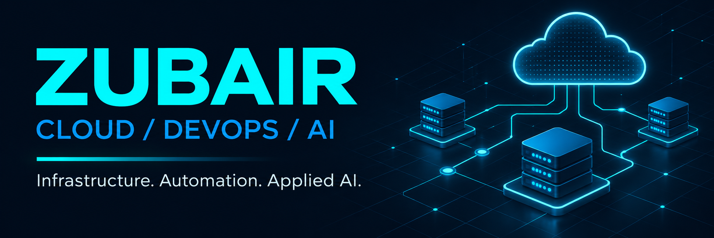
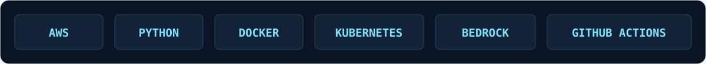

  

  <strong>Building practical systems at the intersection of cloud infrastructure and AI.</strong> 
  Python automation · Observable workflows · Evidence-driven engineering

  <a href="#02--selected-builds">Explore my projects</a> &nbsp; / &nbsp;
  <a href="#03--toolbox">Toolbox</a> &nbsp; / &nbsp;
  <a href="https://github.com/zubairdevops514?tab=repositories">All repositories ↗</a>

---

### `01 / ABOUT`

Hi, I'm **Zubair**. I'm building a Cloud, DevOps, and AI engineering portfolio around useful problems: finding the right runbook during an incident, processing documents reliably, and spotting unexpected cloud spend.

I focus on **clear architecture, reproducible demos, meaningful tests, and honest documentation**. My projects make their tradeoffs and verification status visible.

### `02 / SELECTED BUILDS`

<table>
  <tr>
    <td width="33%" valign="top">
      <h3>01 · Runbook AI</h3>
      
Source-cited troubleshooting for AWS and Kubernetes, with an optional Bedrock generation path.

      
<code>Python</code> <code>BM25</code> <code>Bedrock</code>

      
<strong>Engineering focus</strong> Grounded answers, retrieval evaluation, and explicit no-match handling.

      <a href="https://github.com/zubairdevops514/runbook-ai-assistant">Explore repository →</a>
    </td>
    <td width="33%" valign="top">
      <h3>02 · Document Pipeline</h3>
      
Version-aware S3 events and Lambda processing, with optional AI document summaries.

      
<code>AWS</code> <code>Lambda</code> <code>SAM</code>

      
<strong>Engineering focus</strong> Scoped IAM, bounded inputs, reproducible processing, and failure handling.

      <a href="https://github.com/zubairdevops514/aws-ai-document-pipeline">Explore repository →</a>
    </td>
    <td width="33%" valign="top">
      <h3>03 · Cost Anomalies</h3>
      
Explainable cloud-spend alerts with exact currency arithmetic and a standalone HTML report.

      
<code>Python</code> <code>FinOps</code> <code>MAD</code>

      
<strong>Engineering focus</strong> Transparent baselines, input validation, and reviewable results.

      <a href="https://github.com/zubairdevops514/cloud-cost-anomaly-detector">Explore repository →</a>
    </td>
  </tr>
</table>

  
  
  

### `03 / TOOLBOX`

**Working style:** test failure paths · automate repeatable work · document decisions · measure before claiming results

### `04 / NEXT ITERATION`

- Expand retrieval evaluation with realistic on-call questions and paraphrases.
- Deploy and measure the document pipeline in an AWS sandbox.
- Compare cost-detection baselines against labeled historical data.

Portfolio projects include free local demos. GitHub checks pass; live AWS deployments and model inference are separate validation steps. AWS and Azure course forks remain learning resources.

---

<code>BUILD → TEST → OBSERVE → IMPROVE</code>

